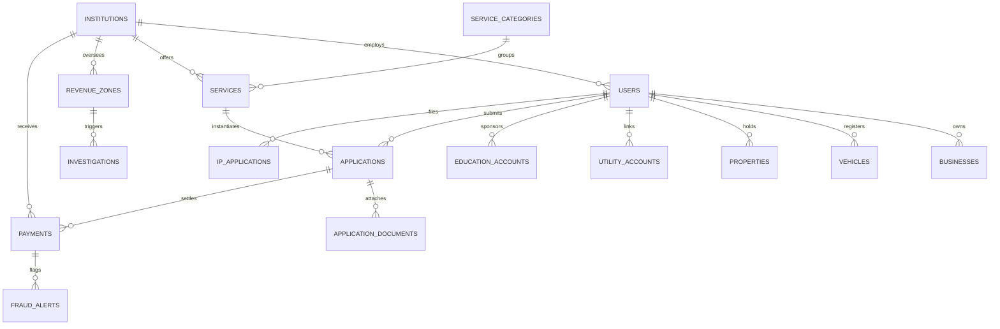

# OneGov Zambia — System Architecture, Database ER Model & API Reference

## 1. Platform Identity & Architectural Philosophy
- **Name**: OneGov (`ONE CITIZEN. ONE ACCOUNT. ONE PLATFORM. EVERY GOVERNMENT SERVICE.`)
- **Positioning**: Independent digital-government aggregator and workflow integration platform complementing participating Zambian institutions (`ZRA`, `RTSA`, `LCC`, `KCC`, `LVCC`, `ZESCO`, `PACRA`, `UNZA`, `NAPSA`, `ZSIC`).
- **Human Authority Rule**: AI assists with document OCR, form completion, council shortfall diagnostics, and preliminary IP similarity screening—**participating institutions retain sole legal authority** over approvals, certificates, and statutory grants.

## 2. Database Entity-Relationship (ER) Overview

## 3. Institutional Isolation & RBAC Matrix
1. **12 Roles**: `citizen`, `small_business_owner`, `business_admin`, `government_officer`, `council_officer`, `institutional_admin`, `zra_admin`, `super_admin`, `finance_officer`, `auditor`, `ip_applicant`, `ip_officer`.
2. **Boundary Enforcement**:
   - Institutional officers (`RTSA`, `LCC`, `ZESCO`, `PACRA`) only access and review applications allocated to their own `institution_id`.
   - `zra_admin` receives consolidated aggregate revenue analytics across institutions/provinces/councils without exposing private citizen NRC/PII records.
   - `super_admin` manages platform configuration, institutional onboarding, and integration health, and is blocked (`403 Forbidden`) from overriding institutional approvals.

## 4. Core REST API Endpoints
- `GET /api/health` — Service health probe
- `GET /api/public/overview` — Public service directory, categories, institutions, regional config
- `POST /api/demo/session` — Switch / authenticate into any of the 12 Demo Sandbox personas
- `POST /api/demo/register` — Register a demo Citizen or SME Business account
- `GET /api/auth/me` — Verified Firebase or Demo Sandbox user profile + notifications
- `GET /api/citizen/overview` — Vehicles, properties, utilities, tuition, businesses, applications, payments, Greener Zambia metrics
- `POST /api/transport/road-tax/quote` — Illustrative RTSA road tax calculation
- `POST /api/applications` & `POST /api/applications/:id/review` — Configurable workflow submission & RBAC-enforced officer review
- `POST /api/payments/sandbox` — Sandboxed Mobile Money / Bank / Card gateway verification & digital receipt issuance
- `GET /api/institution/portal` — Strictly isolated institution workspace
- `GET /api/council/intelligence` & `POST /api/council/investigations` — GIS ward revenue analytics & officer investigation cases
- `GET /api/zra/overview` — ZRA Master Revenue Oversight dashboard API
- `GET /api/ip/records` & `POST /api/ip/applications` — PACRA patent & trademark filing workflow
- `POST /api/ai/assistant`, `/api/ai/document-ocr`, `/api/ai/council-analysis`, `/api/ai/ip-similarity`, `/api/ai/predictive-insights` — Server-side Gemini AI intelligence

## 5. Installation & Deployment
1. Configure `GEMINI_API_KEY`, `SQL_HOST`, `SQL_DB_NAME`, `SQL_USER`, `SQL_PASSWORD`, and `SQL_ADMIN_*` environment variables (or run `docker-compose up --build`).
2. Push schema via `npx drizzle-kit push --config=src/db/drizzle.config.ts`.
3. Start development server via `npm run dev` on port `3000` or build production bundle via `npm run build && npm start`.
